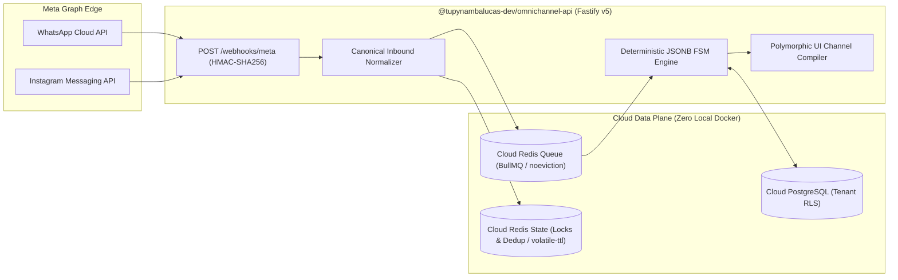

# Enterprise Omnichannel Messaging Platform (`@tupynambalucas-dev/omnichannel`)

Enterprise multi-tenant omnichannel messaging gateway, polymorphic UI channel compiler, and deterministic JSONB Finite State Machine (FSM) workflow engine unifying **WhatsApp Cloud API** and **Instagram Messaging API** on a cloud-native, zero-Docker architecture.

> [!TIP]
> **In-Memory Zero-Config Boot:** When `DATABASE_URL`, `REDIS_QUEUE_URL`, and `REDIS_STATE_URL` are left blank in `.env`, `@tupynambalucas-dev/omnichannel-api` automatically boots with deterministic in-memory repositories and inline pipeline execution so endpoints and FSM transitions can be tested immediately without external containers.

---

## 1. Architecture Overview

`@tupynambalucas-dev/omnichannel` ingests high-concurrency Meta Graph webhooks through a single stateless Fastify v5 edge (`/webhooks/meta`), verifies `X-Hub-Signature-256` HMAC-SHA256 signatures against raw request bytes, normalizes heterogeneous WhatsApp and Instagram events into a single **Canonical Inbound Envelope**, enforces two-layer 24-hour idempotency and per-conversation FIFO ordering, and executes declarative multi-tenant conversation workflows backed by Cloud PostgreSQL (with `FORCE ROW LEVEL SECURITY`) and dual-role Cloud Redis.



```text
omnichannel/
├── .agents/                  # Enterprise Agent Mesh plugin bindings (plugins.json)
├── .vscode/                  # Workspace tasks, settings, and recommended extensions
├── core/                     # @tupynambalucas-dev/omnichannel-core (Zod v4 schemas & FSM contracts)
├── api/                      # @tupynambalucas-dev/omnichannel-api (Fastify v5 gateway & BullMQ workers)
├── references/               # Diataxis engineering documentation & cloud onboarding tutorials
├── eslint.config.ts          # Strict flat-config TypeScript ESLint ruleset
├── pnpm-workspace.yaml       # Centralized pnpm dependency and plugin catalogs
├── tsconfig.base.json        # Shared strict ES2022 / NodeNext compiler options
├── tsconfig.json             # Solution-style TypeScript Project References coordinator
├── tsconfig.node.json        # Root tooling TypeScript configuration
├── turbo.json                # Turborepo task graph orchestration
├── AGENTS.md                 # Sovereign Layer-1 AI agent context router
├── LICENSE.md                # Apache License 2.0
├── package.json              # Root monorepo manifest and pipeline scripts
└── README.md                 # Primary developer documentation
```

---

## 2. Subsystems & Navigation

| Subsystem / Workspace | Package / Scope | Documentation | Agent Context | Responsibilities |
| :--- | :--- | :--- | :--- | :--- |
| **`core/`** | `@tupynambalucas-dev/omnichannel-core` | [`core/README.md`](./core/README.md) | [`core/AGENTS.md`](./core/AGENTS.md) | Shared Zod v4 contracts, Canonical Inbound Envelope, Polymorphic UI Blocks, and FSM Workflow schemas. |
| **`api/`** | `@tupynambalucas-dev/omnichannel-api` | [`api/README.md`](./api/README.md) | [`api/AGENTS.md`](./api/AGENTS.md) | Fastify v5 webhook gateway, BullMQ workers, channel compiler, and PostgreSQL RLS repositories. |
| **`.agents/`** | Agent Customizations | [`.agents/README.md`](./.agents/README.md) | [`.agents/AGENTS.md`](./.agents/AGENTS.md) | `@tupynambalucas-dev/agent-mesh` plugin registrations and workspace guardrails. |
| **`references/`** | Diátaxis Documentation Hub | [`references/README.md`](./references/README.md) | *(inherits root)* | Architectural explanations, reference schemas, and cloud onboarding tutorials. |

### Key Onboarding Tutorials

- [Meta for Developers Registration and Channel Onboarding](./references/tutorials/meta-developer-app-and-channels-onboarding.md)
- [Cloud Databases Provisioning Without Docker (Neon, Upstash, Atlas)](./references/tutorials/cloud-databases-provisioning-without-docker.md)

---

## 3. Environment & Secret Governance

Secrets and cloud connection strings are governed via [`.env.example`](./.env.example) and **Infisical Cloud**. Tenant channel access tokens are never stored in plaintext database columns; `tenant_channels` stores only an immutable secret variable reference (`accessTokenSecretRef`) resolved at runtime from the process environment or Infisical.

| Variable Name | Required | Purpose |
| :--- | :---: | :--- |
| `PORT` / `HOST` | No | HTTP listener binding for `@tupynambalucas-dev/omnichannel-api` (defaults to `3000` / `0.0.0.0`). |
| `META_APP_SECRET` | Yes (Prod) | Meta App Secret used for `X-Hub-Signature-256` raw-body HMAC-SHA256 verification. |
| `META_WEBHOOK_VERIFY_TOKEN` | Yes (Prod) | Challenge verification token for `GET /webhooks/meta`. |
| `DATABASE_URL` | Optional (Dev) | Cloud PostgreSQL connection string (Neon / Supabase) with `FORCE ROW LEVEL SECURITY`. |
| `REDIS_QUEUE_URL` | Optional (Dev) | Cloud Redis (`rediss://`) connection string for BullMQ workers (`maxmemory-policy=noeviction`). |
| `REDIS_STATE_URL` | Optional (Dev) | Cloud Redis (`rediss://`) connection string for 24h deduplication and locks (`volatile-ttl`). |
| `MONGODB_URI` | Optional | MongoDB Atlas connection URI when `MONGODB_ARCHIVE_ENABLED=true`. |

---

## 4. Getting Started

### Prerequisites

- **Node.js**: `>= 22.x` (verified on `v24.x`)
- **pnpm**: `10.33.2` (managed via Corepack)

### Installation & Local Startup

```bash
# 1. Clone the repository
git clone git@github.com:tupynambalucas-dev/omnichannel.git
cd omnichannel

# 2. Install workspace dependencies and Agent Mesh plugins from pnpm catalogs
pnpm install

# 3. Copy the environment template and populate secrets (or inject via Infisical)
cp .env.example .env

# 4. Compile referenced TypeScript packages
pnpm build

# 5. Start the development gateway in watch mode
pnpm api:dev
```

---

## 5. Development & Pipeline Scripts

| Command | Description |
| :--- | :--- |
| `pnpm dev` | Runs `core` compiler watch and `api` hot-reload server in parallel via Turborepo. |
| `pnpm api:dev` | Frees port `3000` and starts `@tupynambalucas-dev/omnichannel-api` in watch mode. |
| `pnpm build` | Compiles `@tupynambalucas-dev/omnichannel-core` and `@tupynambalucas-dev/omnichannel-api` via Turborepo. |
| `pnpm typecheck` | Runs `tsc -b` solution build validation and package-level typechecking. |
| `pnpm lint` | Executes strict type-checked ESLint rules across all packages. |
| `pnpm format:check` | Verifies repository formatting with Prettier. |
| `pnpm format:write` | Formats TypeScript, JSON, YAML, and Markdown files with Prettier. |
| `pnpm clean` | Removes `dist/`, `.turbo/`, and `*.tsbuildinfo` artifacts. |

---

## 6. Governance & Contributing Standards

1. **Cryptographic Commit Signing**: Every Git commit and annotated tag MUST be signed via SSH (`git commit -S -m "..."`).
2. **Conventional Commits**: Commit messages strictly adhere to `<type>(<scope>): <description>` (v1.0.0).
3. **Single-Branch GitHub Flow**: Short-lived branches (`feat/<slug>`, `fix/<slug>`, `docs/<slug>`, `chore/<slug>`) branch off `main` and merge via Pull Request.
4. **Zero-Emoji Invariant**: Emojis are strictly prohibited in source code, logs, documentation, and commits.
5. **Secret Hygiene**: Never commit `.env` files or raw Meta System User tokens. Store only secret variable names (`accessTokenSecretRef`) in `tenant_channels`.
6. **AI Agent Context**: Autonomous agents operating in this repository MUST read [AGENTS.md](./AGENTS.md) before modifying files.

---

## 7. License

Licensed under the [Apache License 2.0](./LICENSE.md). Copyright (c) 2026 tupynambalucas.dev.
