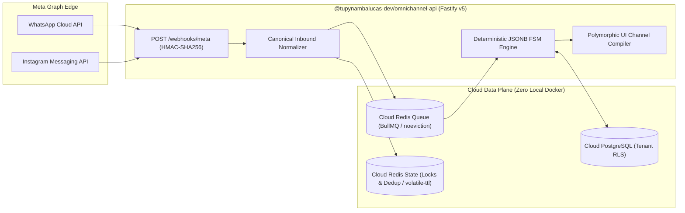

# Enterprise Omnichannel Messaging Platform (`@tupynambalucas-dev/omnichannel`)

Enterprise multi-tenant omnichannel messaging gateway, polymorphic UI channel compiler, and deterministic JSONB Finite State Machine (FSM) workflow engine unifying **WhatsApp Cloud API** and **Instagram Messaging API** on a cloud-native, zero-Docker architecture.

> [!TIP]
> **In-Memory Zero-Config Boot:** When `DATABASE_URL`, `REDIS_QUEUE_URL`, and `REDIS_STATE_URL` are left blank in `.env`, `@tupynambalucas-dev/omnichannel-api` automatically boots with deterministic in-memory repositories, inline pipeline execution, and a pre-bootstrapped enterprise tenant (`tupynamba-lucas-enterprise`) so endpoints and FSM transitions can be tested immediately without external containers.

---

## 1. Architecture Overview

`@tupynambalucas-dev/omnichannel` ingests high-concurrency Meta Graph webhooks through a single stateless Fastify v5 edge (`/webhooks/meta`), verifies `X-Hub-Signature-256` HMAC-SHA256 signatures against raw request bytes, normalizes heterogeneous WhatsApp and Instagram events into a single **Canonical Inbound Envelope**, enforces two-layer 24-hour idempotency and per-conversation FIFO ordering, and executes declarative multi-tenant conversation workflows backed by Cloud PostgreSQL (with `FORCE ROW LEVEL SECURITY`) and dual-role Cloud Redis.



```text
omnichannel/
├── .agents/                  # Enterprise Agent Mesh plugin bindings (plugins.json) & local plans
├── .github/                  # CODEOWNERS, Dependabot, composite actions, and CI workflows
├── .husky/                   # Git pre-commit hook running lint-staged
├── .vscode/                  # Workspace tasks, settings, and recommended extensions
├── core/                     # @tupynambalucas-dev/omnichannel-core (Zod v4 schemas & FSM contracts)
├── api/                      # @tupynambalucas-dev/omnichannel-api (Fastify v5 gateway & BullMQ workers)
├── references/               # Diataxis engineering documentation & cloud onboarding tutorials
├── .env.example              # Authoritative environment configuration template
├── .gitignore                # Git ignore rules (ignores .env and .agents/plans/)
├── .ignore / .rgignore       # Un-ignores .agents/plans/ for IDE & ripgrep indexing
├── .npmrc                    # Scoped registry routing for @tupynambalucas-dev
├── .prettierignore           # Prettier ignore rules
├── .prettierrc.json          # Prettier formatting rules
├── eslint.config.ts          # Strict flat-config TypeScript ESLint ruleset
├── pnpm-workspace.yaml       # Centralized pnpm dependency and plugin catalogs
├── tsconfig.base.json        # Shared strict ES2022 / NodeNext compiler options
├── tsconfig.json             # Solution-style TypeScript Project References coordinator
├── tsconfig.node.json        # Root tooling TypeScript configuration
├── turbo.json                # Turborepo task graph orchestration
├── AGENTS.md                 # Sovereign Layer-1 AI agent context router
├── LICENSE.md                # Apache License 2.0
├── package.json              # Root monorepo manifest and pipeline scripts
└── README.md                 # Primary developer documentation
```

---

## 2. Subsystems & Navigation

| Subsystem / Workspace | Package / Scope                        | Documentation                                    | Agent Context                                    | Responsibilities                                                                                      |
| :-------------------- | :------------------------------------- | :----------------------------------------------- | :----------------------------------------------- | :---------------------------------------------------------------------------------------------------- |
| **`core/`**           | `@tupynambalucas-dev/omnichannel-core` | [`core/README.md`](./core/README.md)             | [`core/AGENTS.md`](./core/AGENTS.md)             | Shared Zod v4 contracts, Canonical Inbound Envelope, Polymorphic UI Blocks, and FSM Workflow schemas. |
| **`api/`**            | `@tupynambalucas-dev/omnichannel-api`  | [`api/README.md`](./api/README.md)               | [`api/AGENTS.md`](./api/AGENTS.md)               | Fastify v5 webhook gateway, BullMQ workers, channel compiler, and PostgreSQL RLS repositories.        |
| **`.agents/`**        | Agent Customizations                   | [`.agents/README.md`](./.agents/README.md)       | [`.agents/AGENTS.md`](./.agents/AGENTS.md)       | `@tupynambalucas-dev/agent-mesh` plugin registrations and workspace guardrails.                       |
| **`references/`**     | Diátaxis Documentation Hub             | [`references/README.md`](./references/README.md) | [`references/AGENTS.md`](./references/AGENTS.md) | Tutorials, how-to runbooks, wire/SQL/HTTP reference specs, and architectural explanations.            |

### Key Documentation Entrypoints

- [Run Your First Conversation Locally (Zero-Config Tutorial)](./references/tutorials/run-first-conversation-locally.md)
- [Meta for Developers Registration and Channel Onboarding](./references/tutorials/meta-developer-app-and-channels-onboarding.md)
- [Cloud Databases Provisioning Without Docker (Neon, Upstash, Atlas)](./references/tutorials/cloud-databases-provisioning-without-docker.md)
- [HTTP API Reference](./references/reference/http-api.md)
- [Environment Variables & Secret References Reference](./references/reference/environment-variables-and-secret-references.md)

---

## 3. Getting Started

### Prerequisites

- **Node.js**: `>= 22.0.0`
- **pnpm**: `10.33.2` (managed via Corepack)

### Installation & Local Startup

```bash
# 1. Clone the repository
git clone git@github.com:tupynambalucas-dev/omnichannel.git
cd omnichannel

# 2. Install workspace dependencies and Agent Mesh plugins from pnpm catalogs
pnpm install

# 3. Copy the environment template and populate secrets (or inject via Infisical)
cp .env.example .env

# 4. Compile referenced TypeScript packages
pnpm build

# 5. Start the development gateway in watch mode
pnpm api:dev
```

### Environment & Secret Governance

Secrets and cloud connection strings are governed via [`.env.example`](./.env.example) and **Infisical Cloud**. Tenant channel access tokens are never stored in plaintext database columns; `tenant_channels` stores only an immutable secret variable reference (`accessTokenSecretRef`) resolved at runtime from `process.env[secretRef]`.

| Variable Name                      |    Required    | Default                                       | Purpose                                                                                           |
| :--------------------------------- | :------------: | :-------------------------------------------- | :------------------------------------------------------------------------------------------------ |
| `NODE_ENV`                         |      Yes       | `development`                                 | Runtime environment (`development`, `production`, `test`).                                        |
| `SERVER_HOST` / `SERVER_PORT`      |      Yes       | `0.0.0.0` / `3000`                            | HTTP listener binding for `@tupynambalucas-dev/omnichannel-api`.                                  |
| `LOG_LEVEL`                        |       No       | `info`                                        | Pino structured log level (`fatal`, `error`, `warn`, `info`, `debug`, `trace`).                   |
| `CORS_ALLOWED_ORIGINS`             |       No       | `http://localhost:3000,http://localhost:5173` | Comma-separated allowed CORS origins.                                                             |
| `META_GRAPH_BASE_URL`              |       No       | `https://graph.facebook.com`                  | Base URL for outbound Meta Graph API calls.                                                       |
| `META_GRAPH_API_VERSION`           |       No       | `v22.0`                                       | Target Meta Graph API version.                                                                    |
| `META_WEBHOOK_VERIFY_TOKEN`        |   Yes (Prod)   | `dev-verify-token`                            | Challenge verification token for `GET /webhooks/meta`.                                            |
| `META_APP_SECRET`                  |   Yes (Prod)   | `""`                                          | Meta App Secret used for `X-Hub-Signature-256` raw-body HMAC-SHA256 verification.                 |
| `DATABASE_URL`                     | Optional (Dev) | `""`                                          | Cloud PostgreSQL connection string (Neon / Supabase) with `FORCE ROW LEVEL SECURITY`.             |
| `DATABASE_SSL_ENABLED`             |       No       | `true`                                        | Enforces TLS on PostgreSQL connections.                                                           |
| `DATABASE_POOL_MAX`                |       No       | `20`                                          | Maximum concurrent clients in `pg.Pool`.                                                          |
| `REDIS_QUEUE_URL`                  | Optional (Dev) | `""`                                          | Cloud Redis (`rediss://`) connection string for BullMQ workers (`maxmemory-policy=noeviction`).   |
| `REDIS_STATE_URL`                  | Optional (Dev) | `""`                                          | Cloud Redis (`rediss://`) connection string for 24h deduplication and locks (`volatile-ttl`).     |
| `MONGODB_ARCHIVE_ENABLED`          |       No       | `false`                                       | Enables optional unstructured webhook payload archival to MongoDB Atlas.                          |
| `MONGODB_URI`                      |    Optional    | `""`                                          | MongoDB Atlas connection URI when `MONGODB_ARCHIVE_ENABLED=true`.                                 |
| `SENTRY_DSN`                       |    Optional    | `""`                                          | Sentry DSN for `5xx` unhandled exception reporting.                                               |
| `DEFAULT_TENANT_AUTO_BOOTSTRAP`    |       No       | `true`                                        | Automatically bootstraps the default enterprise tenant (`tupynamba-lucas-enterprise`) on startup. |
| `DEFAULT_WHATSAPP_PHONE_NUMBER_ID` |       No       | `106540352242922`                             | Default WhatsApp `phone_number_id` registered during auto-bootstrap.                              |

---

## 4. Pipeline Scripts

| Command                             | Description                                                                                              |
| :---------------------------------- | :------------------------------------------------------------------------------------------------------- |
| `pnpm dev`                          | Runs `core` compiler watch and `api` hot-reload server in parallel via Turborepo.                        |
| `pnpm build`                        | Compiles `@tupynambalucas-dev/omnichannel-core` and `@tupynambalucas-dev/omnichannel-api` via Turborepo. |
| `pnpm start`                        | Starts the compiled `@tupynambalucas-dev/omnichannel-api` production server (`node dist/index.js`).      |
| `pnpm typecheck`                    | Runs `tsc -b` solution build validation and package-level typechecking.                                  |
| `pnpm lint`                         | Executes strict type-checked ESLint rules (`strictTypeChecked`) across all packages.                     |
| `pnpm test`                         | Runs the multi-turn workflow simulation and webhook integration test suites across the workspace.        |
| `pnpm format:check`                 | Verifies repository formatting with Prettier.                                                            |
| `pnpm format:write`                 | Formats TypeScript, JSON, YAML, and Markdown files with Prettier.                                        |
| `pnpm clean`                        | Removes `dist/`, `.turbo/`, and `*.tsbuildinfo` artifacts.                                               |
| `pnpm core:build` / `core:lint`     | Package-scoped build, lint, dev, and typecheck commands for `@tupynambalucas-dev/omnichannel-core`.      |
| `pnpm api:dev` / `api:test` / `...` | Package-scoped dev, build, test, start, lint, and typecheck commands for `omnichannel-api`.              |

---

## 5. Governance Standards

1. **Cryptographic Commit Signing**: Every Git commit and annotated tag MUST be signed via SSH (`git commit -S -m "..."`).
2. **Conventional Commits**: Commit messages strictly adhere to `<type>(<scope>): <description>` (v1.0.0).
3. **Single-Branch GitHub Flow**: Short-lived branches (`feat/<slug>`, `fix/<slug>`, `docs/<slug>`, `chore/<slug>`) branch off `main` and merge via Pull Request.
4. **Zero-Emoji Invariant**: Emojis are strictly prohibited in source code, logs, documentation, and commits.
5. **Secret Hygiene**: Never commit `.env` files or raw Meta System User tokens. Store only secret variable names (`accessTokenSecretRef`) in `tenant_channels`.
6. **AI Agent Context**: Autonomous agents operating in this repository MUST read [AGENTS.md](./AGENTS.md) before modifying files.

---

## 6. License

Licensed under the [Apache License 2.0](./LICENSE.md). Copyright (c) 2026 tupynambalucas.dev.
